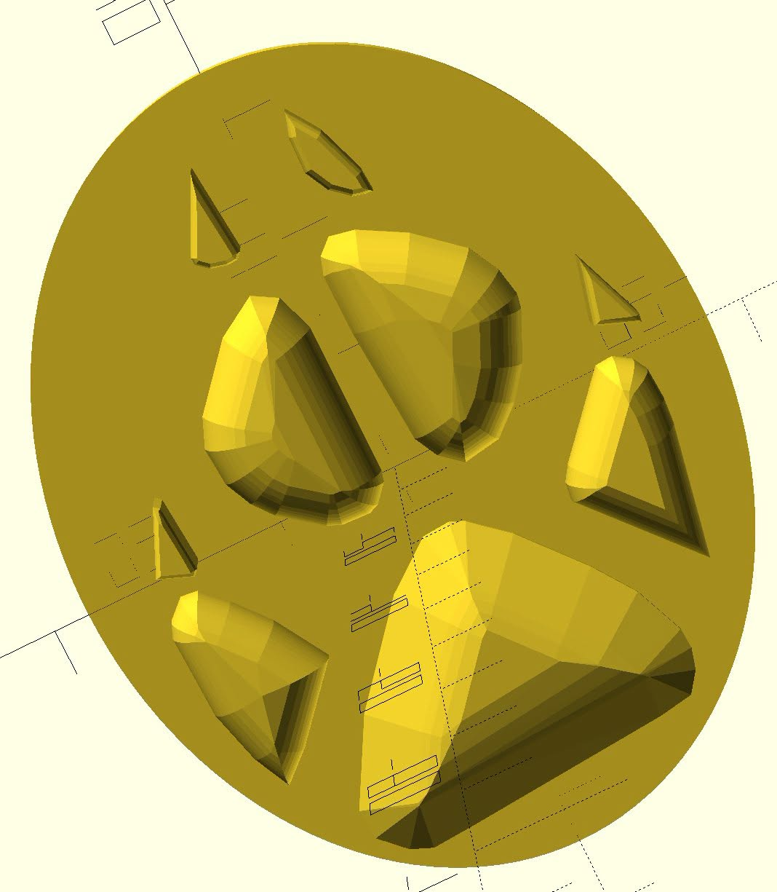

# Animal Tracks Stamps / Razítka stop zvěře



## English

3D-printable **stamps of animal tracks** — press them into mud, clay or sand to
leave a realistic paw/hoof print. Each stamp carries the animal's name
(Czech + English) and **L/R** marking on top of the handle.

### Repository structure

```
Animals-Zvirata/            per-animal directories (all directories use EN-CZ naming)
  Fox-Liska/                stamp model (.scad), printable STL (L+R), source mask,
                            previews, animal-specific notes
Tracks-Stopy/               track outline reference sheets (source images)
Scripts-Skripty/            generators (extract paw outline from a sheet -> .scad)
```

### How a stamp is made

1. Each animal directory has a **`params.json`** config: real track size
   (length × width, verified against online field guides - source links
   included), relief depth, claws, edge rounding, base margin, handle size,
   and the position of the track outline in the reference sheet
   (row/column, text cutoff).
2. `Scripts-Skripty/generate_stamp.py <animal-dir>` extracts the outline
   (threshold → contours → clustering → Douglas–Peucker → scale to real
   size) and generates an OpenSCAD model: base plate, **rounded** relief
   (domed like real paw pads), handle with the animal's name and L/R marker.
3. With `--stl` the script exports both STL variants directly
   (uses OpenSCAD CLI).

Requirements: Python (numpy, Pillow, matplotlib) and OpenSCAD (CLI for STL export).

### Animals / Zvířata

36 animals · 36 zvířat (each has L+R STL, `.scad`, mask, previews, `params.json`):

| Dir / Adresář | Animal / Zvíře | Stamp length / délka stopy |
|---|---|---|
| Fox-Liska | Liška obecná (Red fox) | 57 mm |
| Wolf-Vlk | Vlk obecný (Gray wolf) | 110 mm |
| Bear-Medved | Medvěd hnědý (Brown bear) | 140 mm |
| Boar-PraseDivoke | Prase divoké (Wild boar) | 75 mm |
| Pig-Prase | Prase domácí (Domestic pig) | 80 mm |
| Bull-Byk / Cow-Krava | Býk / Kráva (cattle) | 120 / 110 mm |
| Horse-Kun | Kůň (Horse) | 130 mm |
| Sheep-Ovce | Ovce (Sheep) | 65 mm |
| Rhino-Nosorozec | Nosorožec (Rhino) | 110 mm · scale ~1:2.2 |
| Elephant-Slon | Slon (Elephant) | 110 mm · scale ~1:3.5 |
| Camel-Velbloud | Velbloud (Camel) | 120 mm |
| Llama-Lama | Lama (Llama) | 110 mm |
| Antelope-Antilopa | Antilopa (Antelope) | 60 mm |
| Reindeer-Sob | Sob (Reindeer) | 95 mm |
| Monkey-Opice | Opice (Monkey) | 90 mm |
| Dog-Pes | Pes (Dog, large) | 90 mm |
| Cat-Kocka | Kočka (Domestic cat) | 35 mm |
| Badger-Jezevec | Jezevec (European badger) | 65 mm |
| Polecat-Tchor | Tchoř (European polecat) | 40 mm |
| Squirrel-Veverka | Veverka (Red squirrel) | 70 mm · scale ~1.6× up |
| Hedgehog-Jezek | Ježek (Hedgehog) | 65 mm · scale ~2.5× up |
| Mole-Krtek | Krtek (Mole) | 50 mm · scale ~2× up |
| Mouse-Mys | Myš (Wood mouse) | 35 mm · scale ~3.5× up |
| Hare-Zajic | Zajíc (Brown hare, hind) | 150 mm |
| Kangaroo-Klokan | Klokan (Kangaroo) | 100 mm · scale ~1:3 |
| Opossum-Vacice | Vačice (Opossum) | 55 mm |
| Coati-Nosal | Nosál (Coati) | 80 mm |
| Crocodile-Krokodyl | Krokodýl (Nile crocodile) | 120 mm |
| Frog-Zaba | Žába (Frog) | 45 mm · scale ~2× up |
| Grouse-Tetrev | Tetřev hřímavý (Capercaillie) | 90 mm |
| Chicken-Kure | Kuře (Chicken) | 65 mm |
| Pigeon-Holub | Holub (Pigeon) | 45 mm |
| Duck-Kachna | Kachna (Mallard) | 70 mm |
| Penguin-Tucnak | Tučňák (Penguin) | 120 mm |

Tiny/huge tracks are scaled to a practical stamp size — `scale` is noted in
each `params.json` + README. / Příliš malé/velké stopy jsou přeškálovány na
praktickou velikost razítka — měřítko je uvedeno v `params.json` a README.

The whole set can be regenerated with
`python Scripts-Skripty/batch_generate.py --generate` (seed params for missing
animals + run the generator). / Celou sadu lze přegenerovat skriptem
`batch_generate.py --generate`.

### 3D printing tips

- No supports needed; print text side up, 0.2 mm layers, PLA/PETG.
- Press evenly into soft mud/clay; the relief depth gives the imprint depth.

---

## Česky

Razítka **stop zvířat pro 3D tisk** — zatlačením do bláta, hlíny nebo písku
zanechají realistickou stopu tlapky/kopýtka. Každé razítko má na madlu název
zvířete (česky + anglicky) a označení **L/P** (v STL jako L/R).

### Struktura repozitáže

```
Animals-Zvirata/            adresáře jednotlivých zvířat (pojmenování adresářů EN-CZ)
  Fox-Liska/                model razítka (.scad), tisknutelné STL (L+R), maska stopy,
                            náhledy, upřesňující informace k tlapkám
Tracks-Stopy/               vzorové obrázky stop (zdroj)
Scripts-Skripty/            generátory (extrakce obrysu stopy ze vzoru -> .scad)
```

### Jak razítko vzniká

1. Každý adresář zvířete obsahuje konfiguraci **`params.json`**: reálná velikost
   stopy (délka × šířka, ověřená v online atlasech stop – odkazy uvedeny),
   hloubka reliéfu, drápy, zaoblení hran, okraj základny, rozměry madla
   a pozice stopy ve vzorovém obrázku (řádek/sloupec, oříznutí textu).
2. `Scripts-Skripty/generate_stamp.py <adresar-zvirete>` extrahuje obrys
   (prahování → kontury → shlukování → Douglas–Peucker → přepočet na reálnou
   velikost) a vygeneruje OpenSCAD model: základní deska, **zaoblený** reliéf
   (klenutý jako skutečné polštářky), madlo s názvem a označením L/R.
3. S přepínačem `--stl` skript rovnou exportuje obě STL varianty
   (volá OpenSCAD CLI).

Potřeba: Python (numpy, Pillow, matplotlib) a OpenSCAD (CLI pro export STL).

### Tipy pro tisk

- Bez podpěr; tisknout textem nahoru, vrstva 0.2 mm, PLA/PETG.
- Zatlačit rovnoměrně do měkkého bláta/hlíny — hloubka otisku odpovídá výšce reliéfu.

---

*Project generated in collaboration with Claude Code. No secrets, no credentials
in this repository – ever.*
